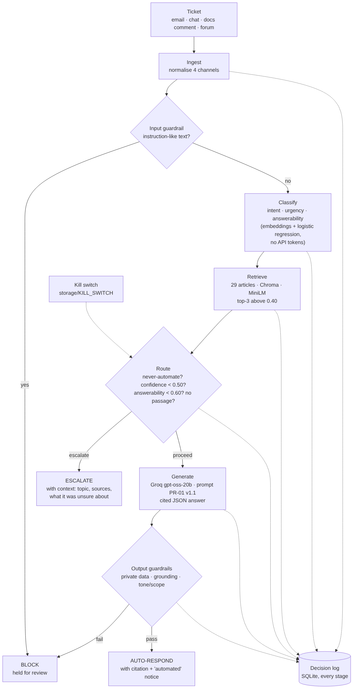
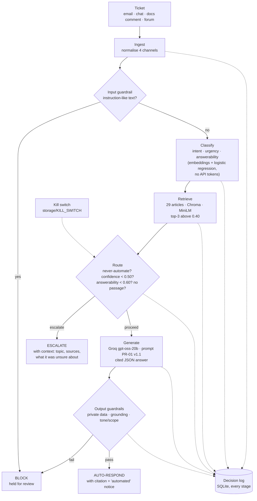

# Architecture

Drafted with Claude (Anthropic), reviewed by Aditya Wakase.

## Components

| Module | Role | Requirement |
|---|---|---|
| `src/ingest.py` | Normalise 4 channels into one Ticket shape; never raises | FR-01 |
| `src/guardrails.py` (input) | Block instruction-like tickets before the model | FR-06 |
| `src/classify.py` | Intent, urgency, answerability (MiniLM + logistic regression, no API calls) | FR-02, FR-13 |
| `src/retrieve.py` | Chunk 29 articles, Chroma index, top-3 above relevance threshold | FR-03 |
| `src/route.py` | Ordered, deterministic rules with plain-language reasons; escalation package | FR-04, FR-07 |
| `src/generate.py`, `src/llm.py` | Cited JSON answer via Groq; cache, pacing, retries, circuit breaker | FR-05, FR-09 |
| `src/guardrails.py` (output) | Private data, grounding, tone/scope | FR-06 |
| `src/logging_store.py` | SQLite decision log, one row per stage | FR-08 |
| `evaluation/harness.py`, `metrics.py` | Unattended run + metrics report | A9, A10 |

## Decisions (set in `.env`, measured with `python -m evaluation.tune`)

| Setting | Value | Why |
|---|---|---|
| CHUNK_STRATEGY | whole | Higher hit rate with less retrieval on unanswerable tickets; keeps resolution steps intact |
| RELEVANCE_THRESHOLD | 0.40 | 91.6% hit rate on answerable development tickets |
| CONFIDENCE_THRESHOLD | 0.50 | 99.3% topic accuracy on tickets that pass |
| ANSWERABLE_THRESHOLD | 0.60 | Compromise between wrong answers and automatic resolution (PRD v2.0, FR-13) |
| Never-automate intents | security, compliance, data residency, feature request, unclear | Daniel's interview; labels; gate-run evidence |
